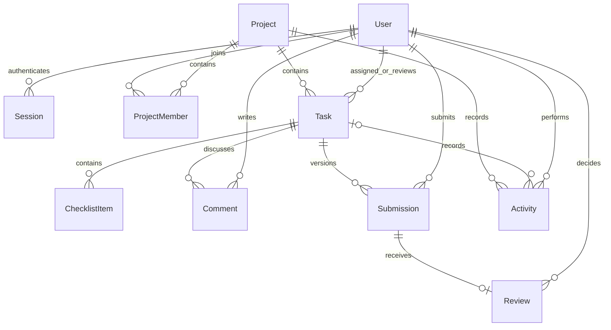

# DevTrack

A project workspace for a small software team. Plan work, assign an independent reviewer, submit revisions, and finish only after approval.

Built with React + TypeScript + Vite, Express, Prisma/PostgreSQL, and Socket.IO. The interface uses Tailwind, shadcn-style Radix components, TanStack Query, and dnd-kit. All seeded names, projects, emails, and work links are fictional.

## Run locally on this Windows computer

Open this folder in VS Code and use its terminal:

```powershell
npm ci
npm run db:local
npm run db:generate
npm run db:migrate
npm run db:seed
npm run dev
```

Open **http://127.0.0.1:5173**. Keep the terminal running. The browser app uses port 5173, the API/socket server uses 4100, and the separate PostgreSQL instance uses 55439.

Requirements: Node.js 22.16 or newer compatible Node LTS; PostgreSQL binaries. The Windows helper defaults to `C:\Program Files\PostgreSQL\18\bin`; set `PG_BIN` if installed elsewhere. It creates a dedicated `.local-db` directory bound to loopback, generates a database password into ignored `.env`, and creates `devtrack` and `devtrack_test`. It does not modify your other PostgreSQL service. The first database initialization must be run before customizing `.env`.

The frontend targets modern browsers: Chrome/Edge 120+, Firefox 128+, and Safari 17+. Chromium desktop and a 390px mobile viewport are covered by automated tests; other browser engines have not been verified here.

For an existing PostgreSQL server or another operating system, copy `.env.example` to `.env`, provide your own `DATABASE_URL`, and create a separate database ending in `_test` for `TEST_DATABASE_URL`. Skip `db:local`. Both databases need migration privileges; only local development/migration credentials need database-owner rights.

Stop the dev terminal with Ctrl+C. Stop only the dedicated database with:

```powershell
powershell -NoProfile -ExecutionPolicy Bypass -File scripts/local-db.ps1 -Stop
```

### Fictional demo accounts

Default local password for every demo account: **`LocalDemo!2026`**. This is intentionally documented demo access, not a production credential. Set `DEMO_PASSWORD` before the first seed to choose a different one. Re-running the seed keeps existing accounts, passwords, projects, and work intact.

- `admin@devtrack.demo` — Morgan Lee, workspace admin.
- `manager@devtrack.demo` — Alex Chen, manager of Website redesign.
- `developer@devtrack.demo` — Jamie Park, task owner.
- `reviewer@devtrack.demo` — Sam Rivera, independent reviewer.
- `outsider@devtrack.demo` — Taylor Brooks, a different private project.

Use separate browser profiles/incognito windows to try simultaneous accounts.

## Product behavior

- **Overview:** accessible project summaries, task counts, personal focus, and recent team activity.
- **My tasks:** personal assignments and a separate review queue.
- **Projects:** create projects as admin; project managers manage memberships, task assignments, and project settings.
- **Board/List:** search by title/key, filter priority and assignee, drag cards, or use the task's keyboard-accessible Move task selector.
- **Task detail:** description, checklist, comments, submissions, review decisions, and activity history.
- **Members:** active company directory; admins invite/deactivate accounts and revoke pending invitations.
- **Invitations:** single-use links, valid for 48 hours. Creating a replacement revokes older unused invitations for that email. The secret link is shown only on creation. Delivery is manual; no email is sent.

### Review workflow

`To do → In progress → In review → Done`

The assignee and reviewer must be distinct, active members of the project. Only a project manager/admin creates tasks or changes assignments. The assignee can edit their own work and submit it after completing its checklist. Submission requires an HTTP/HTTPS work link and notes. Only the assigned reviewer can approve or request changes; an admin cannot bypass review.

Review locks the task content and checklist. Comments remain available. The assignee can withdraw to edit. A requested change returns the task to In progress; resubmitting creates a new immutable revision. A manager can reopen Done with an explanation, and another review is then required. Tasks have no direct delete operation in v1.

At least one manager remains on each project. Active tasks/reviews must be reassigned before removing/deactivating their owner/reviewer. Completed work preserves its original references; re-adding the original active members is necessary before reopening work whose participants have since left. Archived projects are read-only until restored.

## Architecture and data

```text
React UI ── REST /api ── Express policies + Zod ── Prisma ── PostgreSQL
   │                              │
   └──── Socket.IO updates ────────┘ (after a successful commit)
```



An Invitation stores a hashed one-time token and email; acceptance creates the User. Sessions use hashed random identifiers, a PostgreSQL store, a seven-day absolute expiry, and a per-session CSRF token. Passwords use Argon2id. Auth cookies are HttpOnly and SameSite=Lax; enable `COOKIE_SECURE=true` behind HTTPS.

Access is enforced on every API resource and socket subscription. Mutations require JSON, the `X-DevTrack-Request` header, and (when authenticated) `X-CSRF-Token`; browser origins are checked. Login/acceptance are rate limited. Input strings have bounds; comments are rendered as text. Submitted links are never fetched by the backend.

Task mutations use serializable transactions and optimistic version checks. A stale edit returns HTTP 409; concurrent changes are never silently overwritten. Status changes and their activity events commit together. Database constraints also prohibit self-review and non-positive versions.

Socket events carry invalidation signals, not authoritative data. Clients fetch current state after joining/reconnecting. Removed members leave project rooms immediately; deactivated accounts and logged-out sessions lose sockets. Expired sessions are swept every 30 seconds. REST always checks session validity per request. PostgreSQL remains the source of truth.

### Source map

- `src/` — React pages, task board/detail, shared UI components and styles.
- `server/` — HTTP/socket application, persistence access, and workflow policies.
- `shared/contracts.ts` — Zod request contracts and frontend DTO types.
- `prisma/` — schema, versioned migrations, and idempotent fictional seed.
- `tests/` — business-rule tests, database-backed integration tests, browser workflows.

### API surface

- Auth: `POST /api/auth/login`, `POST /api/auth/accept`, `GET /api/auth/me`, `POST /api/auth/logout`.
- Users/invitations: `GET/PATCH /api/users`, `GET/POST/DELETE /api/invitations` (mutations use resource IDs where applicable).
- Projects: `GET/POST /api/projects`, `PATCH /api/projects/:id`, `POST /api/projects/:id/members`, `DELETE /api/projects/:id/members/:userId`.
- Tasks: `GET /api/tasks`, `GET /api/tasks/:id`, `POST /api/projects/:id/tasks`.
- Task actions: `POST /api/tasks/:id/{edit,move,submit,review,withdraw,reopen,checklist,comments}`. All task-changing actions except comments require the current numeric `version`.
- Activity: `GET /api/activities`. Health: `GET /api/health` checks the database.

Responses return JSON; errors use `{ "error": "Helpful explanation" }`. Validation is 400, missing sessions 401, forbidden actions 403, inaccessible projects/tasks 404, and concurrent/state conflicts 409. Socket clients authenticate with the same cookie plus CSRF token; `project:join` acknowledges `{ok: boolean}`. `project:changed` and `access:changed` trigger refetches.

## Tests and production build

```powershell
npm run test
npm run build
npx playwright install chromium
npm run test:e2e
npm audit
```

**Tests clear only `TEST_DATABASE_URL`, whose database name must end with `_test`.** Never point it to a database containing valuable data. API tests and browser tests use the same disposable database; run them sequentially. E2E starts its own server on port 4201, seeds fictional data, and tests the built frontend. It does not change the normal demo database. The local dev server can remain open.

The suites cover review/revision/reopen, stale writes, CSRF/origin protection, invitation lifecycle, permissions, archive rules, membership/socket eviction, multi-browser updates, reconnect, failed drag rollback, keyboard interaction, mobile layout, and automated accessibility checks. Browser screenshots are saved in `docs/screenshots`; traces/videos and the HTML report are in ignored test output directories.

The dependency lock is included in the deliverable. `.npmrc` avoids a peer-resolver crash in the host's npm 10 when resolving Vitest's optional peer packages. The actual installed direct dependency tree is checked with `npm ls --depth=0`. Narrow overrides update Prisma's configuration-only merge/effect dependencies and esbuild to patched releases; migration, generation, test, and build checks verify compatibility.

A GitHub Actions workflow is included for the same checks with PostgreSQL 18. It has not been run on GitHub; this project has not been published or pushed to a remote repository.

To serve the production build locally, stop the dev server and run:

```powershell
$env:APP_ORIGIN = 'http://127.0.0.1:4100'
npm start
```

Express serves both the built frontend and API on **http://127.0.0.1:4100**. Set the origin back to 5173 when returning to Vite development. Keep `COOKIE_SECURE=false` for local HTTP. Publishing, a reverse proxy, domain setup, and public demo isolation are outside this local deliverable.

## Demo walkthrough

1. Sign in as manager. Open Website redesign and create a task for Jamie with Sam as reviewer.
2. Sign in as developer in another window. Move the task to In progress, add/finish a checklist item, and submit a work link.
3. As reviewer, request a specific change. Watch the developer's task return to In progress without refreshing.
4. Submit a second revision and approve it. Open Submissions to show both revisions and decisions.
5. As manager, reopen it with a reason. Explain that completion still requires another independent review.
6. As outsider, try the Website redesign URL: the server denies access.

Inspiration: [Anuj's Trello clone](https://github.com/Anuj-er/trello-clone), [Knowankit's Trello clone](https://github.com/knowankit/trello-clone), and [Planka](https://github.com/plankanban/planka). These informed the product study; this implementation does not copy their application source.

V1 deliberately excludes multiple companies, billing, automated email/password recovery, file uploads, GitHub integration, AI, and standalone chat. It targets a small local portfolio team; there is no offline write queue, horizontal socket scaling, or production monitoring service.
