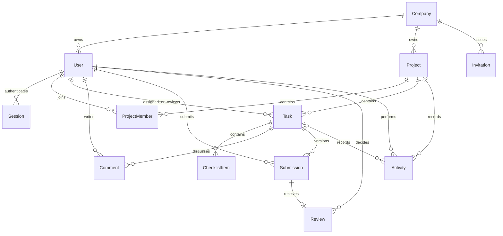

# DevTrack

DevTrack adalah aplikasi manajemen proyek untuk tim pengembang perangkat lunak. Anggota dapat membagi tugas, mengirim hasil kerja, meminta revisi, dan menyelesaikan tugas setelah reviewer yang berbeda dari penanggung jawab menyetujuinya.

Aplikasi ini dibuat dengan React, TypeScript, Vite, Express, Prisma, PostgreSQL, dan Socket.IO. Antarmuka menggunakan Tailwind, komponen Radix bergaya shadcn, TanStack Query, dan dnd-kit. Semua nama, proyek, email, dan tautan dalam data demo bersifat fiktif.

## Menjalankan secara lokal di Windows

Buka folder proyek di VS Code, lalu jalankan melalui terminal:

```powershell
powershell -NoProfile -ExecutionPolicy Bypass -File .\Start-DevTrack.ps1
```

Buka **http://127.0.0.1:5173** dan biarkan terminal tetap berjalan. Skrip akan memasang dependensi jika diperlukan, menyiapkan database lokal khusus DevTrack, menerapkan migrasi, mengisi akun demo, dan menjalankan aplikasi. Frontend memakai port 5173, API/socket memakai 4100, dan PostgreSQL lokal memakai 55439.

Persyaratan: Node.js 22.16 atau versi LTS kompatibel yang lebih baru, serta berkas program PostgreSQL. Skrip Windows mencari PostgreSQL di `C:\Program Files\PostgreSQL\18\bin`; atur `PG_BIN` jika lokasinya berbeda. Database dibuat di `.local-db` dan hanya menerima koneksi dari komputer ini. Kata sandinya disimpan di `.env` yang diabaikan Git. Skrip membuat database `devtrack` dan `devtrack_test` tanpa mengubah layanan PostgreSQL lain. Jalankan inisialisasi pertama sebelum mengubah `.env`.

Frontend ditujukan untuk Chrome/Edge 120+, Firefox 128+, dan Safari 17+. Pengujian browser otomatis mencakup Chromium desktop dan tampilan ponsel selebar 390px; mesin browser lainnya belum diverifikasi di sini.

Jika memakai PostgreSQL yang sudah ada atau sistem operasi lain, salin `.env.example` menjadi `.env`, isi `DATABASE_URL`, dan buat database pengujian terpisah dengan nama berakhiran `_test` untuk `TEST_DATABASE_URL`. Lewati `db:local`. Kedua database memerlukan izin migrasi; hak pemilik database hanya diperlukan oleh kredensial pengembangan/migrasi lokal.

Hentikan server pengembangan dengan Ctrl+C. Untuk menghentikan hanya database khusus DevTrack:

```powershell
powershell -NoProfile -ExecutionPolicy Bypass -File scripts/local-db.ps1 -Stop
```

### Akun demo fiktif

Kata sandi awal semua akun demo lokal adalah **`LocalDemo!2026`**. Ini kredensial demo yang sengaja didokumentasikan, bukan kata sandi produksi. Atur `DEMO_PASSWORD` sebelum pengisian data pertama jika ingin menggantinya. Pengisian ulang tidak menghapus akun, kata sandi, proyek, atau pekerjaan yang sudah ada.

- `admin@devtrack.demo` — Morgan Lee, admin workspace.
- `manager@devtrack.demo` — Alex Chen, manajer proyek Website redesign.
- `developer@devtrack.demo` — Jamie Park, penanggung jawab tugas.
- `reviewer@devtrack.demo` — Sam Rivera, reviewer independen.
- `outsider@devtrack.demo` — Taylor Brooks, anggota proyek privat lain.

Gunakan profil browser atau jendela incognito berbeda untuk mencoba beberapa akun bersamaan.

Untuk membuat perusahaan baru, buka **http://127.0.0.1:5173/register** atau pilih **New company? Create a workspace** di halaman masuk. Isi nama perusahaan, nama pemilik, email, dan kata sandi minimal 12 karakter. Pemilik langsung masuk sebagai admin dengan workspace kosong. Setelah membuat proyek, admin dapat mengundang rekan melalui **Members**. Setiap akun hanya tergabung dalam satu perusahaan; email terdaftar tidak dapat dipakai untuk mendaftarkan perusahaan lain. Demo lokal ini belum memverifikasi kepemilikan email.

### Mengirim undangan melalui email

Untuk DevTrack di Railway Free/Trial/Hobby, gunakan API HTTPS Resend. Verifikasi domain di Resend, buat API key dengan akses **Sending**, lalu tambahkan variabel berikut ke **layanan devtrack → Variables** di Railway (jangan masukkan ke GitHub):

```dotenv
RESEND_API_KEY="your-resend-api-key"
RESEND_FROM="invites@your-verified-domain.com"
```

Terapkan perubahan agar Railway menjalankan ulang layanan. Alamat pengirim harus memakai domain terverifikasi. Jangan bagikan API key melalui chat atau commit. Resend diutamakan jika terkonfigurasi. Untuk pengembangan lokal atau host yang mengizinkan SMTP, gunakan variabel berikut di `.env` yang diabaikan Git:

```dotenv
SMTP_HOST="smtp.example.com"
SMTP_PORT=587
SMTP_SECURE=false
SMTP_FROM="invites@example.com"
SMTP_USER="your-smtp-username"
SMTP_PASSWORD="your-smtp-password-or-app-password"
```

Gunakan host, port, kredensial, dan alamat pengirim terverifikasi dari penyedia email. Port 587 menggunakan STARTTLS; untuk port 465, atur `SMTP_SECURE=true`. Kredensial dapat dikosongkan jika memakai relay SMTP lokal tepercaya. Jangan commit kredensial asli. Di **Members**, masukkan email penerima lalu pilih **Send invitation**. DevTrack menyatakan berhasil saat penyedia menerima pesan; email masuk ke inbox tetap bergantung pada penyedia. Jika pengiriman gagal, tautan baru dicabut dan undangan lama yang masih tertunda tetap berlaku. Tanpa konfigurasi email, formulir yang sama menghasilkan tautan sekali pakai untuk dibagikan manual.

Nilai awal `APP_ORIGIN=http://127.0.0.1:5173` membuat tautan undangan hanya berfungsi di komputer ini. Agar dapat diakses orang di perangkat lain, aplikasi memerlukan alamat HTTPS publik dan `APP_ORIGIN` yang sesuai.

## Fitur utama

- **Overview:** ringkasan proyek, jumlah tugas, pekerjaan pribadi, dan aktivitas tim terbaru.
- **My tasks:** tugas pribadi serta antrean review terpisah.
- **Projects:** admin membuat proyek; manajer proyek mengelola anggota, tugas, dan pengaturan proyek.
- **Board/List:** cari berdasarkan judul/kunci, saring prioritas dan penanggung jawab, seret kartu, atau gunakan pilihan **Move task** yang dapat dioperasikan dengan keyboard.
- **Task detail:** deskripsi, checklist, komentar, pengajuan hasil, keputusan review, dan riwayat aktivitas.
- **Members:** daftar anggota dengan jabatan opsional, misalnya UI Designer. Admin dapat mengisi atau mengubah jabatan, menonaktifkan akun, serta mencabut undangan. Jabatan hanya menjelaskan pekerjaan seseorang dan tidak memberikan hak akses.
- **Invitations:** tautan sekali pakai berlaku 48 jam. Resend atau SMTP yang terkonfigurasi mengirimkannya ke email penerima; jika tidak, tautan rahasia hanya ditampilkan saat dibuat untuk dibagikan manual. Undangan pengganti yang berhasil terkirim mencabut undangan lama yang belum digunakan untuk email yang sama.
- **Companies:** pemilik dapat membuat workspace baru. Pengguna, proyek, tugas, undangan, dan aktivitas dibatasi berdasarkan perusahaan; kunci proyek yang sama dapat digunakan perusahaan berbeda.

### Alur review

`To do → In progress → In review → Done`

Penanggung jawab dan reviewer harus berbeda serta menjadi anggota aktif proyek. Hanya manajer proyek/admin yang dapat membuat tugas atau mengubah penugasan. Penanggung jawab dapat mengedit tugasnya dan mengajukan hasil setelah checklist selesai. Pengajuan memerlukan tautan hasil kerja HTTP/HTTPS dan catatan. Hanya reviewer yang ditunjuk yang dapat menyetujui atau meminta revisi; admin tidak dapat melewati review.

Selama review, isi tugas dan checklist terkunci, tetapi komentar tetap tersedia. Penanggung jawab dapat menarik pengajuan untuk mengeditnya. Permintaan revisi mengembalikan tugas ke **In progress**; pengajuan ulang membuat versi hasil baru yang tidak berubah. Manajer dapat membuka kembali tugas **Done** dengan alasan, lalu tugas harus melewati review lagi. Versi pertama belum menyediakan penghapusan tugas secara langsung.

Setiap proyek harus memiliki setidaknya satu manajer. Penanggung jawab/reviewer tugas aktif harus dialihkan sebelum dikeluarkan atau dinonaktifkan. Tugas selesai tetap menyimpan rujukan ke orang yang semula terlibat; jika orang itu sudah keluar, ia harus kembali menjadi anggota aktif sebelum tugas dibuka ulang. Proyek yang diarsipkan hanya dapat dibaca sampai dipulihkan.

## Arsitektur dan data

```text
React UI ── REST /api ── Express policies + Zod ── Prisma ── PostgreSQL
   │                              │
   └──── Socket.IO updates ────────┘ (setelah perubahan berhasil disimpan)
```



Migrasi menempatkan data demo lama di workspace Studio. Pendaftaran baru membuat `Company` dan admin `User` dalam satu transaksi. `Invitation` terhubung ke perusahaan serta menyimpan email dan hash token sekali pakai; penerimaannya membuat `User` di perusahaan itu. Sesi disimpan di PostgreSQL dengan pengenal acak yang di-hash, kedaluwarsa mutlak setelah tujuh hari, serta token CSRF per sesi. Kata sandi di-hash dengan Argon2id. Cookie autentikasi memakai HttpOnly dan SameSite=Lax; aktifkan `COOKIE_SECURE=true` saat memakai HTTPS.

Hak akses diperiksa pada setiap sumber daya API dan langganan socket, termasuk batas perusahaan bagi admin. Perubahan data memerlukan JSON, header `X-DevTrack-Request`, dan, jika sudah masuk, `X-CSRF-Token`; origin browser juga diperiksa. Percobaan masuk, pendaftaran, dan penerimaan undangan dibatasi. Panjang input dibatasi; komentar ditampilkan sebagai teks biasa. Backend tidak mengambil isi tautan hasil kerja.

Perubahan tugas memakai transaksi serializable dan pemeriksaan nomor versi. Edit berdasarkan versi lama menghasilkan HTTP 409 agar perubahan orang lain tidak tertimpa diam-diam. Perubahan status dan catatan aktivitas disimpan bersama. Batasan database melarang review terhadap tugas sendiri serta nomor versi yang tidak positif.

Event socket hanya memberi sinyal untuk memuat ulang data. Klien mengambil keadaan terbaru setelah bergabung atau tersambung kembali. Anggota yang dikeluarkan segera keluar dari room proyek; akun yang dinonaktifkan dan sesi yang logout kehilangan koneksi socket. Sesi kedaluwarsa diperiksa setiap 30 detik. Setiap permintaan REST tetap memeriksa validitas sesi. PostgreSQL adalah sumber data utama.

### Struktur kode

- `src/` — halaman React, board/detail tugas, komponen UI bersama, dan gaya.
- `server/` — aplikasi HTTP/socket, akses penyimpanan, serta aturan alur kerja.
- `shared/contracts.ts` — kontrak permintaan Zod dan tipe DTO frontend.
- `prisma/` — skema, migrasi berversi, dan data contoh fiktif yang aman dijalankan ulang.
- `tests/` — pengujian aturan bisnis, integrasi database, serta alur browser.

### API

- Autentikasi: `POST /api/auth/register`, `POST /api/auth/login`, `POST /api/auth/accept`, `GET /api/auth/me`, `POST /api/auth/logout`.
- Pengguna/undangan: `GET/PATCH /api/users`, `GET/POST/DELETE /api/invitations` (perubahan memakai ID sumber daya jika diperlukan).
- Proyek: `GET/POST /api/projects`, `PATCH /api/projects/:id`, `POST /api/projects/:id/members`, `DELETE /api/projects/:id/members/:userId`.
- Tugas: `GET /api/tasks`, `GET /api/tasks/:id`, `POST /api/projects/:id/tasks`.
- Tindakan tugas: `POST /api/tasks/:id/{edit,move,submit,review,withdraw,reopen,checklist,comments}`. Semua tindakan yang mengubah tugas, kecuali komentar, memerlukan `version` terbaru.
- Aktivitas: `GET /api/activities`. Kesehatan layanan: `GET /api/health` memeriksa database.

Respons menggunakan JSON; kesalahan berbentuk `{ "error": "Helpful explanation" }`. Validasi menghasilkan 400, sesi tidak ada 401, tindakan terlarang 403, proyek/tugas yang tidak dapat diakses 404, dan konflik versi/keadaan 409. Klien socket diautentikasi dengan cookie dan token CSRF yang sama; `project:join` mengembalikan `{ok: boolean}`. Event `project:changed` dan `access:changed` memicu pemuatan ulang data.

## Pengujian dan build produksi

```powershell
npm run test
npm run build
npx playwright install chromium
npm run test:e2e
npm audit
```

**Pengujian hanya mengosongkan `TEST_DATABASE_URL`, yang nama databasenya wajib berakhiran `_test`.** Jangan arahkan ke database berisi data penting. Pengujian API dan browser memakai database sementara yang sama; jalankan berurutan. Pengujian E2E menjalankan server sendiri pada port 4201, mengisi data fiktif, dan menguji frontend hasil build. Database demo biasa tidak diubah; server pengembangan lokal boleh tetap berjalan.

Pengujian mencakup pendaftaran dan isolasi perusahaan, review/revisi/pembukaan ulang, edit dengan versi lama, perlindungan CSRF/origin, siklus undangan, izin akses, arsip, pencabutan akses anggota/socket, perubahan di beberapa browser, koneksi ulang, pengembalian posisi kartu saat gagal disimpan, keyboard, tampilan ponsel, dan aksesibilitas otomatis. Screenshot browser disimpan di `docs/screenshots`; trace/video dan laporan HTML berada di folder hasil pengujian yang diabaikan Git.

Lockfile dependensi disertakan. `.npmrc` menghindari kegagalan penyelesaian peer dependency pada npm 10 di lingkungan host saat memasang paket opsional Vitest. Dependensi langsung diperiksa dengan `npm ls --depth=0`. Override terbatas memperbarui dependensi konfigurasi Prisma dan esbuild ke rilis yang telah diperbaiki; migrasi, pembuatan kode, pengujian, dan build digunakan untuk memeriksa kompatibilitas.

Workflow GitHub Actions juga disertakan untuk pemeriksaan yang sama dengan PostgreSQL 18. Workflow tersebut belum dijalankan di GitHub.

Untuk menjalankan build produksi secara lokal, hentikan server pengembangan lalu jalankan:

```powershell
$env:APP_ORIGIN = 'http://127.0.0.1:4100'
npm start
```

Express melayani frontend hasil build dan API pada **http://127.0.0.1:4100**. Kembalikan origin ke port 5173 saat memakai Vite lagi. Untuk HTTP lokal, gunakan `COOKIE_SECURE=false`.

### Deploy ke Render dengan Neon

Berkas `render.yaml` mengatur satu layanan web Render gratis. Layanan membangun frontend dan backend, menerapkan migrasi Prisma saat mulai, dan memeriksa `/api/health`. Gunakan proyek PostgreSQL Neon terpisah untuk aplikasi online. Deploy **tidak** mengisi akun demo lokal karena kata sandinya tercantum dalam dokumentasi. Setelah deploy pertama, daftarkan perusahaan dan akun pemilik melalui URL publik.

1. Push proyek ini ke repositori GitHub tanpa menyertakan `.env`, `.local-db`, atau `node_modules`.
2. Buat proyek PostgreSQL di Neon, lalu salin connection string pooled-nya. Jaga kerahasiaannya.
3. Di Render, buat Blueprint dari repositori GitHub tersebut. Isi `DATABASE_URL` yang diminta `render.yaml` dengan connection string Neon. Pilih paket gratis yang ditampilkan Blueprint.
4. Setelah Render menyatakan deploy aktif, buka URL `https://…onrender.com`, daftarkan workspace pertama, lalu periksa login, pembuatan proyek, dan apakah data tetap ada setelah refresh.

Render menyediakan `RENDER_EXTERNAL_URL` secara otomatis untuk tautan undangan dan pemeriksaan origin. Jika memakai domain sendiri, isi `APP_ORIGIN` dengan origin HTTPS yang tepat. Blueprint sudah mengatur `COOKIE_SECURE=true` dan `HOST=0.0.0.0`. Tautan undangan manual langsung dapat digunakan. Layanan web gratis Render memblokir port SMTP keluar 25, 465, dan 587; gunakan penyedia email melalui port yang didukung untuk pengiriman otomatis. Layanan gratis Render dapat memerlukan sekitar satu menit untuk aktif kembali setelah diam 15 menit.

### Deploy ke Railway dengan Neon

Railway Free mendukung satu layanan Express + Vite dan WebSocket ini. Kredit uji coba dan kuota gratis bulanannya terbatas; pantau penggunaan di dashboard Railway. Akun **Limited Trial** dapat membatasi koneksi keluar ke database Neon. Jika aplikasi tidak dapat terhubung ke Neon, periksa apakah akun mendapat akses Full Trial sebelum mengubah kode aplikasi.

1. Masuk ke Railway dengan GitHub lalu pilih **New Project → Deploy from GitHub repo → `ainsalimah/devtrac`**. Biarkan root repositori sebagai root layanan. Railpack membaca `.node-version` untuk Node 22.16.0.
2. Di **Variables**, isi `DATABASE_URL` dengan connection string **pooled** dari proyek Neon `DevTrack`, lalu atur `COOKIE_SECURE=true` dan `NODE_ENV=production`. Simpan connection string hanya di Railway; jangan commit atau tempel di chat. Jangan salin seluruh `.env` lokal.
3. Di **Settings → Build**, atur perintah build menjadi `npm run db:generate && npm run build`. Jika perintah saat ini diawali `npm ci --include=dev &&`, hapus awalan itu: Railpack sudah memasang dependensi, sedangkan pemasangan ulang saat build dapat gagal dengan `EBUSY` pada cache `node_modules/.vite`. Di **Settings → Deploy**, atur perintah mulai menjadi `npm run db:migrate && npm start` dan jalur healthcheck menjadi `/api/health`.
4. Di **Settings → Networking**, pilih **Generate Domain**. Railway menyediakan `RAILWAY_PUBLIC_DOMAIN` untuk tautan undangan dan pemeriksaan origin. Server memakai `PORT` dari Railway dan mendengarkan pada `0.0.0.0`. Terapkan perubahan yang tertunda dan deploy ulang setelah menambahkan domain.
5. Buka URL HTTPS yang dibuat. Daftarkan perusahaan dan akun admin sendiri, lalu buat proyek. Deploy publik tidak mengisi akun demo lokal. Tautan undangan dapat disalin dari **Members**.

Railway Free/Trial/Hobby memblokir SMTP keluar. Biarkan variabel SMTP kosong; gunakan `RESEND_API_KEY` dan `RESEND_FROM` untuk pengiriman otomatis, atau bagikan tautan undangan manual. Resend memerlukan domain pengirim yang terverifikasi.

## Skenario demo

1. Masuk sebagai manajer. Buka **Website redesign**, lalu buat tugas untuk Jamie dengan Sam sebagai reviewer.
2. Masuk sebagai developer di jendela lain. Pindahkan tugas ke **In progress**, tambahkan dan selesaikan checklist, lalu ajukan tautan hasil kerja.
3. Sebagai reviewer, minta perubahan spesifik. Tugas developer kembali ke **In progress** tanpa refresh.
4. Kirim revisi kedua dan setujui. Buka **Submissions** untuk melihat kedua versi dan keputusan review.
5. Sebagai manajer, buka kembali tugas dengan alasan. Penyelesaiannya tetap membutuhkan review independen lagi.
6. Sebagai anggota proyek lain, coba buka URL **Website redesign**: server akan menolak akses.
7. Daftarkan perusahaan kedua di jendela privat, buat proyek `WEB` miliknya, lalu pastikan adminnya tidak dapat melihat pengguna atau tugas perusahaan demo.

Inspirasi produk: [Trello clone karya Anuj](https://github.com/Anuj-er/trello-clone), [Trello clone karya Knowankit](https://github.com/knowankit/trello-clone), dan [Planka](https://github.com/plankanban/planka). Ketiganya dipakai sebagai bahan studi produk; kode aplikasinya tidak disalin ke DevTrack.

Versi ini mendukung beberapa perusahaan yang terisolasi, tetapi satu akun hanya dapat berada di satu perusahaan. Cakupannya belum meliputi billing, verifikasi email, pemulihan kata sandi otomatis, unggahan berkas, integrasi GitHub, AI, atau chat terpisah. Aplikasi juga belum memiliki antrean perubahan offline, penskalaan socket horizontal, atau layanan pemantauan produksi.
